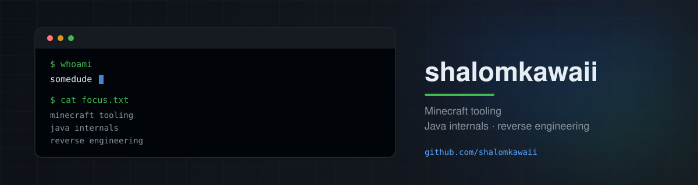

<p align="center">
  
</p>

### Hey, I'm somedude.

I build small, focused tools for the Java and Minecraft ecosystem. I like
problems that sit close to the runtime: class files, bytecode, obfuscation,
and the messy edges of real-world jars.

Right now I'm building **[mcdc](https://github.com/shalomkawaii/minecraft-decompiler)**,
a zero-dependency Python CLI that decompiles Minecraft jars into a source
folder and warns you when a plugin or mod is obfuscated.

---

### What I'm working on

- **mcdc** - one command, safe extraction, transparent obfuscation reports.
- Learning more about JVM bytecode, class-file parsing, and static analysis.
- Open to feedback, bug reports, and interesting reverse-engineering problems.

### Tools I reach for


### Featured project

[**mcdc - Minecraft decompiler**](https://github.com/shalomkawaii/minecraft-decompiler)

> Decompile Minecraft JARs into a source folder. Get a clear warning when the
> jar is obfuscated. Works with official client/server jars, modern bundled
> server jars, mods, and ordinary Java jars.

```bash
pipx install git+https://github.com/shalomkawaii/minecraft-decompiler.git
mcdc decompile server.jar
```

---

### How I work

- Small tools over large frameworks.
- The safe path should be the default path.
- Explain the result, not just print it.
- No magic. If a score is shown, the reasons are shown too.

<p align="center">
  <a href="https://github.com/shalomkawaii">
    
  </a>
  <a href="https://github.com/shalomkawaii/minecraft-decompiler/issues">
    
  </a>
</p>
